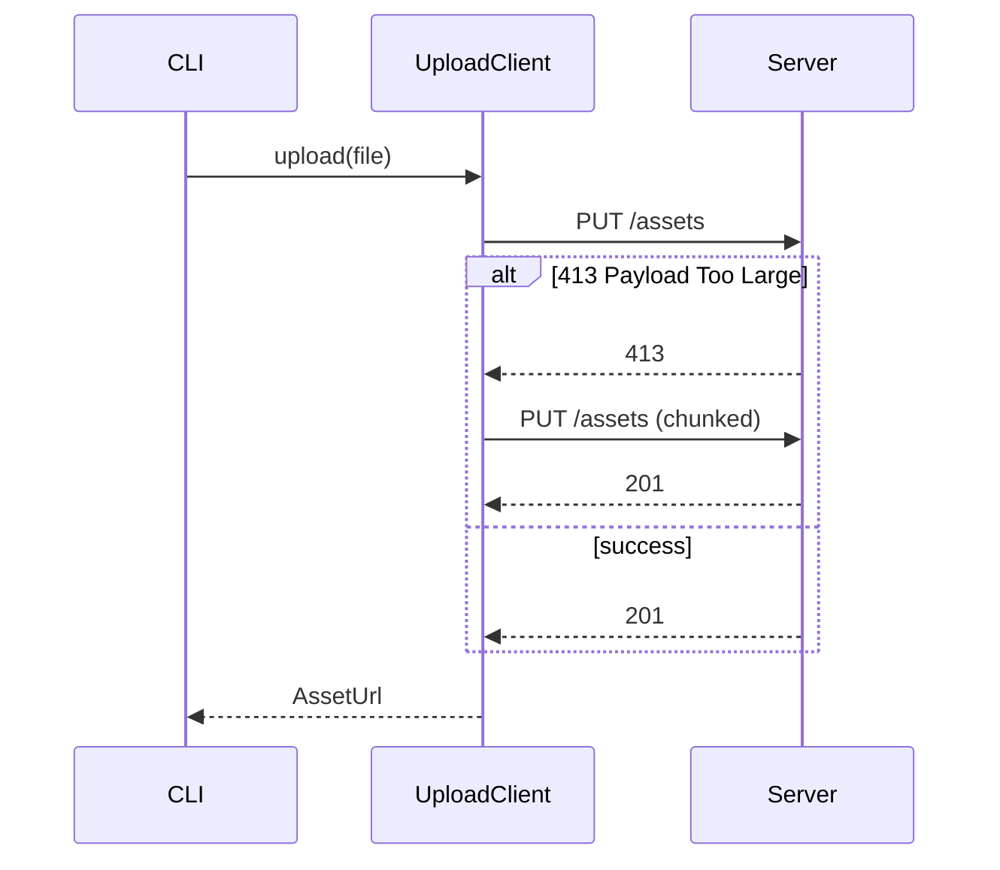

# PR Body Template

Pick sections by what the reviewer needs, not by what the template offers. Do not invent content to fill a heading. A small local change needs a `Summary` (with a linked issue when applicable) and `Verification`. Add `User prompts` only when substantive requirements from the user's prompts help explain the change.

## Summary

Begin with two or three complete sentences explaining the problem, resulting behavior, and why the change is needed.

```markdown
## Summary

Uploads over ~10MB failed silently because the client dropped the response body on a 413.
This surfaces the error to the caller and retries once with chunked transfer.

- close #482
```

Closing issues: put each on its own line as a list item, `- close #123`, so GitHub renders them as pretty issue cards. Use `- refs #123` for issues the PR should not close.

For a larger PR, explain the result in plain language that readers outside the module can understand.

For a stacked PR add a line such as `Stacked on #480; only the last two commits belong to this PR.`

## User prompts

Extract the main ideas from the user's prompts that shaped this PR: intended behavior, scope, constraints, and acceptance criteria. Write each as a direct requirement, not a report of the conversation. Use only requirements the user actually stated; do not add inferred intent or the agent's reasoning.

- Avoid framing such as "asked to", "said to", "requested", "wanted", or "corrected". State the requirement itself.
- Omit routine workflow instructions such as committing, pushing, creating a PR, assigning reviewers, or adding labels. Include requirements about those operations only when they are functionality this PR changes, such as a PR-writing skill or release command.
- Omit roleplay, credentials, flattery, and persona instructions such as "you are a professional TypeScript developer with ten years of experience".
- Omit generic quality language such as "production-ready", "enterprise-grade", "polished", or "give it character". Preserve any concrete requirement attached to that language, such as supporting keyboard navigation or validating request bodies.
- Combine repeated requirements and use the final requirement when a correction supersedes an earlier one. Include earlier wording only when it explains a material tradeoff.
- Keep only requirements relevant to this PR. Drop pleasantries, secrets, model and harness attribution, and agent-authorship disclosures.

```markdown
## User prompts

- Retry uploads that fail with HTTP 413 at most once.
- Surface upload errors in the CLI.
```

One substantive requirement needs only one bullet. Omit this section entirely when the prompts contain only workflow instructions or generic quality language.

## Evidence by change type

A description conveys belief, not proof. Show the change working instead of saying it works. Put the matching proof in `Verification` (or a dedicated `## Evidence` section for larger PRs).

| Change                  | Evidence                                                                                                           |
| ----------------------- | ------------------------------------------------------------------------------------------------------------------ |
| Visible UI              | Same page before and after, same size and crop; short video if it moves. See [visual-evidence](visual-evidence.md) |
| Bug fix                 | Same input on both sides, plus the output each time                                                                |
| Faster or cheaper       | Same workload measured on both sides, more than once                                                               |
| Command or build output | Real captured output before and after, never retyped                                                               |
| New API                 | The code someone would write to use it                                                                             |

- "Before" is what is live (base branch, production, last deploy), never a faked revert.
- Check every capture. Agents can confidently screenshot or measure the wrong thing.
- Use demo or sanitized data only.
- State what was not run, for example `Not checked in a browser yet.`
- Security fixes are the exception: keep the description short and delay exploit details until release.

## Change map

Use when the diff touches several modules or moves responsibility between them. Rows are modules or boundaries, not files.

```markdown
## Change map

| Module          | Before                      | After                                               | Description                                             |
| --------------- | --------------------------- | --------------------------------------------------- | ------------------------------------------------------- |
| `upload/client` | Swallowed non-2xx responses | Maps 413 to `PayloadTooLarge`, retries once chunked | Callers can distinguish size errors from network errors |
| `cli/upload`    | Printed generic "failed"    | Prints the mapped error and hint                    | Actionable output for users                             |
```

A short responsibility tree helps when the layout itself is the change:

```text
server/
├── routes/      # accept and validate input
├── domain/      # own the invariants
└── adapters/    # talk to external systems
```

## Architecture and behavior

Use a diagram when it explains the change faster than prose. Keep node names tied to real modules or symbols and label arrows with calls, events, or data.

- Module flow (`flowchart LR`) for a cross-module feature or boundary move.
- Sequence diagram for changed ordering, async work, retries, cancellation, or cleanup. Match each `alt` branch to a code branch.
- State diagram for changed transitions or terminal states.

For a fix that changes flow or state, show a `Before` and `After` pair at the same abstraction level, then name the exact edge or step that changed so the reader does not have to diff the diagrams.



When a diagram would be expected but does not apply, say so: `Not applicable: only renames a constant, no runtime flow changes.`

## Boundaries and risks

Use when the change has real failure modes, invariants, migrations, or external effects. Include only rows that matter.

```markdown
## Boundaries and risks

| Invariant or boundary        | Failure mode                    | Protection                       | Evidence or gap                         |
| ---------------------------- | ------------------------------- | -------------------------------- | --------------------------------------- |
| Retry happens at most once   | Infinite loop on persistent 413 | `attempt` counter, hard cap of 1 | `upload.test.ts` "does not retry twice" |
| Chunked upload is idempotent | Duplicate asset on retry        | Server dedupes by content hash   | Not verified in this PR                 |
```

Risk groups to scan: input validation and auth; failure mapping, retries, duplicates, concurrency, ordering, cleanup; schema changes, backfills, rollback; secrets in logs or error payloads; UI loading, error, empty, stale, and repeated-action states.

Write `Not verified` instead of turning a risk question into a claim.

## Visual changes

Only for user-visible UI changes. Image row first, label row second. See [visual-evidence](visual-evidence.md) for capture and attachment.

```markdown
## Visual changes

| Before                                    | After                                     |
| ----------------------------------------- | ----------------------------------------- |
|  |  |
| Settings / Connection, 1440x900, dark     | Settings / Connection, 1440x900, dark     |
```

Use `Absent` for a new state and `Removed` for a deleted one.

## Rollout and follow-up

Optional. Migrations, feature flags, staged rollout, monitoring, known gaps, required follow-up PRs. State whether each gap blocks merge.

<!--
Source references:
- https://github.com/moeru-ai/airi/blob/main/.agents/skills/create-pr/references/pr-body.md
- https://hugorcd.com/writing/what-my-pull-requests-look-like-now (Hugo Richard: evidence by change type, honesty rules, plain-language ending)
-->
