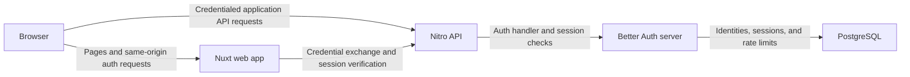

# Identity and Access Management

This workspace provides email and password sign-up, sign-in, account pages, and
sign-out. PostgreSQL stores identities and sessions. Nuxt handles the browser
experience, and the Nitro API provides the authentication and authorization
boundary for application requests.

## Workspace map

| Workspace                                       | Responsibility                                                                      |
| ----------------------------------------------- | ----------------------------------------------------------------------------------- |
| [Web app](apps/web/README.md)                   | Account pages, same-origin form endpoints, and the sealed Nuxt session              |
| [API](apps/api/README.md)                       | Better Auth HTTP routes, trusted origins, CORS, and session checks for API requests |
| [Auth package](packages/auth/README.md)         | Better Auth server configuration, credential policy, and session lifecycle          |
| [Database package](packages/database/README.md) | PostgreSQL connection, schema, relations, and migrations                            |
| [Shared package](packages/shared/README.md)     | Schema-derived contracts and environment validation                                 |



Start with the workspace that owns the behavior you want to change. The [API
README](apps/api/README.md) explains request authorization, the [web
README](apps/web/README.md) explains browser and SSR flows, and the [auth
README](packages/auth/README.md) explains the Better Auth policies that both
applications rely on.

## Local setup

Install Vite+ and OpenSSL, then make an existing PostgreSQL server reachable
from the host. Run the commands below from the repository root. The repository
pins Node.js, pnpm, and dependency versions in its manifests.

```sh
vp install
vp run build
vp run create-env
vp run packages:database migrate
```

The workspace build prepares the shared utilities before building the database,
then builds the shared contracts, auth package, and apps. Use the full build on
a fresh checkout. After a change to an internal package, rebuild consumers
before relying on a standalone app bundle.

| Local file                                         | Values                                                   |
| -------------------------------------------------- | -------------------------------------------------------- |
| [auth example](packages/auth/.env.example)         | API and trusted web origins, plus the Better Auth secret |
| [web example](apps/web/.env.example)               | Browser API origin and the Nuxt session secret           |
| [database example](packages/database/.env.example) | Host, port, database, role, password, and optional TLS   |

`vp run create-env` creates missing `.env` files and generates the two secrets
independently with `openssl rand -base64 32`. In a terminal it prompts for
PostgreSQL details, including a hidden password, when the database file is
missing or still matches its example. A noninteractive run can leave database
placeholders for a later interactive run. Existing configured files are
preserved by default. Keep the `.env` files local and quote manually edited
dotenv values with double quotes.

Use `vp run create-env --force` to recreate the files and rotate both secrets.
It prompts again for database credentials in a terminal. A noninteractive
forced run restores the database example values. Restarting with replacement
secrets invalidates prior sessions.

The migration command applies pending SQL and can create the configured
database when it is missing. See [database migrations](packages/database/README.md#schema-and-migrations)
for privileges and the database bootstrap behavior.

Start the API and web app in separate terminals.

```sh
vp run apps:api dev
vp run apps:web dev
```

Open `http://localhost:5173/signup`. The web app uses port 5173 and the API
uses port 3000. Use `localhost` consistently in the browser URLs and auth
configuration so both apps receive the appropriate cookies.

## Containers

Use the same local environment files and run migrations on the host first.
Compose builds the two apps and connects the API to your existing PostgreSQL
server through the host gateway.

```sh
vp run docker --help
vp run docker up
vp run docker ps
vp run docker --app api logs --follow
vp run docker --app web stop
vp run docker down
```

`up` builds and starts the selected services in the background. Omit `--app`
or pass `--app all` to target both apps. With an app selected, `down` stops and
removes that service's container. The API and web ports are published on
loopback.

| Option               | Use                                                                                                                                                                                                     |
| -------------------- | ------------------------------------------------------------------------------------------------------------------------------------------------------------------------------------------------------- |
| `--container docker` | Use Docker. The wrapper targets Docker Desktop when its `desktop-linux` context exists. Otherwise it uses the configured Docker context, falling back to `default` when the selected context is `kiri`. |
| `--container kiri`   | Use Kiri. On macOS the wrapper also checks `~/.kiri/bin` and the installed app bundle.                                                                                                                  |
| Omit `--container`   | With both CLIs installed, a terminal asks whether to use Kiri. Enter selects Docker. A noninteractive run defaults to Docker where available. If only Kiri is available, the wrapper uses it.           |

```sh
vp run docker --container kiri --app api build
vp run docker --container docker up
```

The API container reads the auth and database workspace files. It uses
`host.docker.internal` for PostgreSQL. Set `DOCKER_DB_HOST` in your shell or
the root `.env` when the container needs a different address. The host
PostgreSQL instance must accept connections from that gateway.

The web container uses `http://api:3000` for server requests and
`NUXT_PUBLIC_API_URL` for browser requests. Set `DOCKER_WEB_API_URL` when the
API is hosted elsewhere. Use the host gateway when running only the web app
in a container and the API on the host.

```sh
DOCKER_WEB_API_URL="http://host.docker.internal:3000" \
  vp run docker --app web up
```

## Deployment

Build the workspaces with `vp run build`. The Node entry point for each app is
`.output/server/index.mjs` in its workspace build output. For Docker, the
images already run this entry point. Supply credentials as environment
variables at runtime, including `APP_ENV="production"` for the API. Apply
migrations before deploying the API.

- Set `AUTH_URL` and `AUTH_WEB_ORIGIN` to the public HTTPS origins. Configure
  the ingress to provide trustworthy client IP information for rate limits.
  [API deployment configuration](apps/api/README.md#configuration)
- Set `NUXT_PUBLIC_API_URL` to the browser API origin and `NUXT_API_URL` when
  Nuxt servers need a separate upstream address.
  [Web runtime configuration](apps/web/README.md#runtime-configuration)
- Keep the auth and web secrets stable across restarts and consistent across
  replicas of the component that uses each secret.
- Ensure the browser can send the API session cookie on requests to the web
  host for SSR. Localhost ports share a cookie host. Separate subdomains need
  an intentional cookie and origin configuration. Keep secure cookies enabled
  on HTTPS deployments. [Web cookie requirements](apps/web/README.md#cookies-and-origins)

## Validation

```sh
vp run check
vp run test
vp run typecheck
vp run build
```

Use `vp run apps:api …`, `vp run apps:web …`, `vp run packages:database …`, or
`vp run packages:shared …` for individual workspace scripts. The auth package
uses `vp run '@iam/auth#build'` and similar Vite+ workspace selectors.

### Integration tests

Use a migrated, disposable PostgreSQL database named `iam`, owned by the
`iam` role, on `127.0.0.1`. The tests use password `disposable` or a local
fixture with trust authentication. They create and delete test identities and
rate-limit records. Set `AUTH_TEST_DB_PORT` to the fixture port.

These commands use a fixture listening on port 55439.

```sh
APP_ENV="testing" DB_HOST="127.0.0.1" DB_PORT="55439" DB_USER="iam" \
  DB_PASSWORD="disposable" DB_DATABASE="iam" DB_SSL="false" \
  vp run packages:database migrate

AUTH_TEST_DB_PORT="55439" vp run test apps/api/tests
```

The API tests run in-process. The [web SSR tests](apps/web/README.md#validation)
also require running builds of both apps against the fixture. Tests that depend
on the fixture are skipped in the default run.

## Common setup failures

| Symptom                                          | Where to check                                                                                                                                                |
| ------------------------------------------------ | ------------------------------------------------------------------------------------------------------------------------------------------------------------- |
| PostgreSQL reports `3D000` or a missing database | Check `DB_DATABASE` and run the [migration command](packages/database/README.md#schema-and-migrations) with a role that can create the database if necessary. |
| API container exits on startup                   | Read `vp run docker --app api logs` and check the auth and database files. A standalone API image expects runtime variables and defaults to production mode.  |
| Kiri build cannot start                          | Check that the Kiri engine is running. If its VM was manually stopped, start it in Kiri and rerun the command.                                                |
| Sign-in succeeds but the account page redirects  | Check the [cookie requirements and SSR flow](apps/web/README.md#cookies-and-origins).                                                                         |
| API returns `401`, `403`, or `503`               | Use the [API response table](apps/api/README.md#authentication-responses) to distinguish a missing session, an origin mismatch, and an auth service failure.  |
