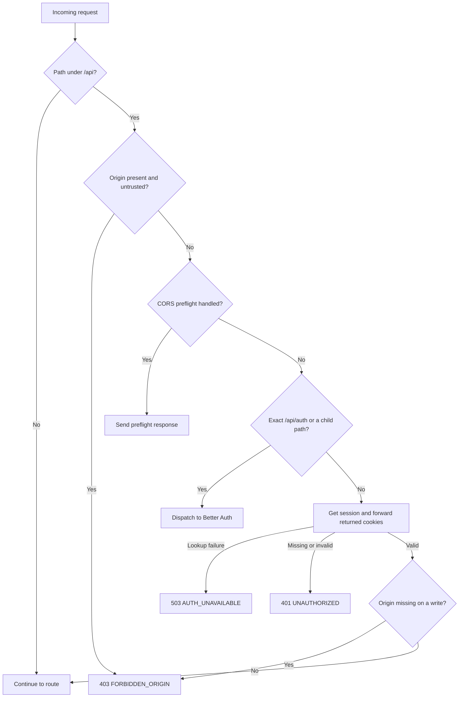

# Identity and Access Management API

The Nitro API hosts Better Auth under `/api/auth/**`. Its authentication
middleware checks origins and sessions for API requests. Better Auth's
configuration and database policies are covered in the [auth package
README](../../packages/auth/README.md).

## Run locally

Follow the [root setup](../../README.md#local-setup) to build the workspaces,
create the env files, and apply database migrations. Start the API from the
repository root.

```sh
vp run apps:api dev
```

The dev server listens on `http://localhost:3000`. The directory's [public
page](public/index.html) is a static landing page. Use the workspace's Nitro CLI
script to check that the auth handler responds.

```sh
vp run apps:api fetch /api/auth/ok
```

Build the API before running its preview.

```sh
vp run apps:api build
vp run apps:api preview
```

## Configuration

| Value             | Source and use                                                                                                                                                |
| ----------------- | ------------------------------------------------------------------------------------------------------------------------------------------------------------- |
| `APP_ENV`         | `local` loads workspace files. `testing`, `staging`, and `production` use process variables. The API container defaults to `production`.                      |
| `AUTH_SECRET`     | Better Auth signing secret. Store locally in `packages/auth/.env`.                                                                                            |
| `AUTH_URL`        | Public API origin, `http://localhost:3000` locally.                                                                                                           |
| `AUTH_WEB_ORIGIN` | Trusted web origin, `http://localhost:5173` locally.                                                                                                          |
| `DB_*`            | PostgreSQL connection settings. The [database package](../../packages/database/README.md#configuration) loads them from its own workspace file in local mode. |

Use absolute HTTP origins without paths or trailing slashes. In production,
inject the auth and database variables into the API process and configure HTTPS
at ingress. Keep the configured public origins aligned with the browser's URLs.
Ingress must supply trustworthy client IP headers so Better Auth can apply
rate limits to the right clients.

The [lifecycle plugin](server/plugins/lifecycle.ts) calls `useAuth()` during
startup to initialize auth and validate both configurations. The PostgreSQL pool
opens connections on demand. Nitro closes that shared pool during shutdown.
Run migrations before starting the API.

## Authentication routes

The [catch-all handler](server/api/auth/%5B...all%5D.ts) passes the incoming
Web `Request` to `useAuth().handler()` and returns the resulting response. It
leaves the body, status, and `Set-Cookie` headers under Better Auth's control.

| Method and route               | Purpose                                                                                            |
| ------------------------------ | -------------------------------------------------------------------------------------------------- |
| `POST /api/auth/sign-up/email` | Register from name, email, and password. Successful registration can start a session.              |
| `POST /api/auth/sign-in/email` | Check credentials and issue a session cookie.                                                      |
| `GET /api/auth/get-session`    | Resolve the session from the request cookie. The response can renew the cookie.                    |
| `POST /api/auth/sign-out`      | End the current session and clear its cookie.                                                      |
| `GET /api/auth/ok`             | Check that Better Auth's HTTP handler responds. Use a session request to exercise database lookup. |

These are the endpoints exercised by the two apps and tests. Better Auth
supplies the handler and owns the full set of routes available under the
auth prefix.

## Request authorization

The [auth middleware](server/middleware/auth.ts) covers `/api` and paths under
`/api/`. It sets `Cache-Control: no-store`, rejects untrusted origins when an
`Origin` header is present, and handles credentialed CORS. Allowed methods are
`GET`, `HEAD`, `POST`, `PUT`, `PATCH`, `DELETE`, and `OPTIONS`.
Browser preflights may request `Content-Type` and `Authorization`.



The middleware uses a path boundary for the auth exception. For example,
`/api/authentication` still requires a session. Routes outside `/api` proceed
without this middleware's auth checks. The Better Auth handler applies its own
rules to requests under `/api/auth`.

For protected paths, the middleware calls `getSession()` once with the request
headers and requests response headers so it can forward every `Set-Cookie`.
It then requires an Origin on methods other than `GET`, `HEAD`, and `OPTIONS`.
If a protected write lacks both a session and an origin, the session check
returns `401` first.

### Authentication responses

| Status | Code               | Meaning                                                                                           |
| ------ | ------------------ | ------------------------------------------------------------------------------------------------- |
| `401`  | `UNAUTHORIZED`     | A protected route has no valid Better Auth session.                                               |
| `403`  | `FORBIDDEN_ORIGIN` | The origin is untrusted, or a protected write with a valid session lacks an Origin.               |
| `503`  | `AUTH_UNAVAILABLE` | The session lookup failed. The API records a generic server event and returns a generic response. |

These codes come from Nitro middleware. Requests handled by Better Auth can
return its own endpoint errors, such as invalid credentials or a rate-limit
response. Keep authorization specific to a resource or action in its own route
or service. The global middleware verifies login status.

## Validation

```sh
vp run apps:api typecheck
vp run test apps/api/tests
```

Set `AUTH_TEST_DB_PORT` for the [disposable PostgreSQL fixture](../../README.md#integration-tests).
The auth suite exercises registration, hashed credentials, session reads,
revocation, and rate limits against PostgreSQL. The middleware suite mounts
the handlers in H3 to check route boundaries, preflight, trusted origins, and
protected requests.

[Nitro Node server deployment](https://nitro.build/deploy/runtimes/node)
