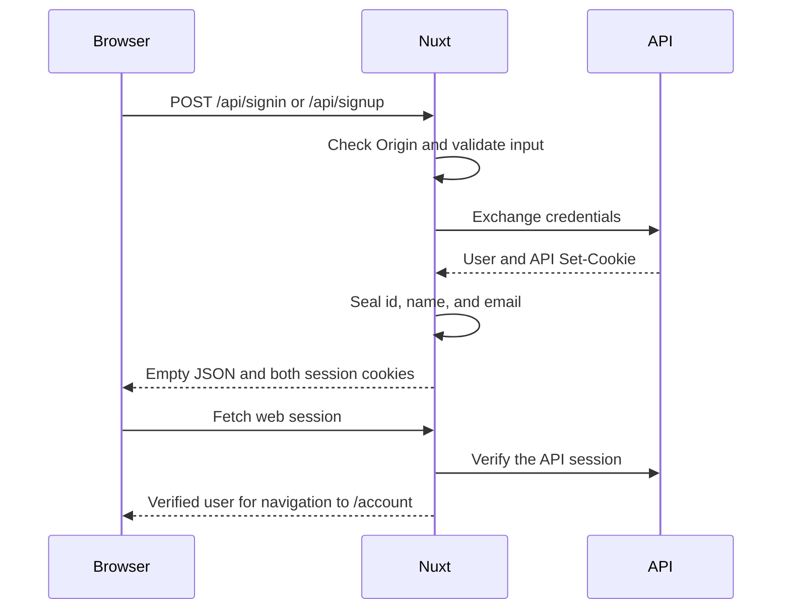
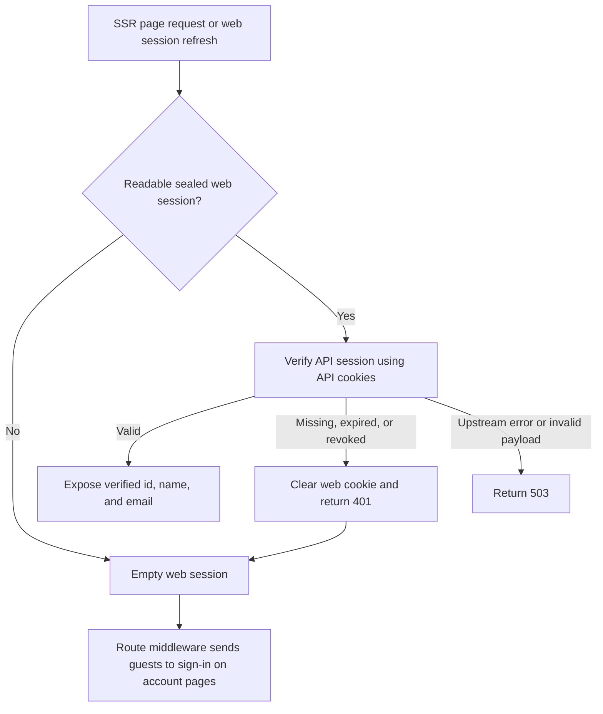

# Identity and Access Management web app

The Nuxt app provides sign-up, sign-in, and account pages. It sends credentials
through its own server endpoints, keeps a sealed web session with Nuxt Auth
Utils, and checks the active session with the API before rendering account
pages. See the [API README](../api/README.md) for authorization of application
API requests.

## Run locally

Complete the [root setup](../../README.md#local-setup). From the repository
root, run the API with `vp run apps:api dev` and start the web app in a
separate terminal.

```sh
vp run apps:web dev
```

Open `http://localhost:5173/signup`. The web app also works with containers
using the [root Docker workflow](../../README.md#containers).

## Runtime configuration

| Variable                     | Use                                                                                                                                          |
| ---------------------------- | -------------------------------------------------------------------------------------------------------------------------------------------- |
| `NUXT_PUBLIC_API_URL`        | Browser-accessible API origin. Defaults to `http://localhost:3000`. The browser uses it for application API calls.                           |
| `NUXT_API_URL`               | Optional server-only API origin. The Nuxt server uses it for auth and application API calls. An empty value falls back to the public origin. |
| `NUXT_APP_SECRET`            | Secret that Nuxt Auth Utils uses to seal the web session. Generate it with `vp run create-env` and use the same value across web replicas.   |
| `NUXT_SESSION_COOKIE_SECURE` | Defaults to `true`. Compose sets it to `false` for local HTTP. Use `false` for local HTTP previews and keep it enabled on HTTPS deployments. |

The local file is `apps/web/.env`. The [example](.env.example) contains the
public API URL and web secret. Compose sets `NUXT_API_URL` to
`http://api:3000` by default, with `DOCKER_WEB_API_URL` available as a host-side
override.

## Pages and navigation

| Page                                                                    | Access                                                                |
| ----------------------------------------------------------------------- | --------------------------------------------------------------------- |
| [`/`](app/pages/index.vue)                                              | Redirects to `/account`.                                              |
| [`/signin`](app/pages/signin.vue) and [`/signup`](app/pages/signup.vue) | Guest pages. A signed-in user is redirected to `/account`.            |
| [`/account`](app/pages/account.vue)                                     | Requires a logged-in web session. Guests are redirected to `/signin`. |

The [global route middleware](app/middleware/auth.global.ts) reads the page's
`auth` metadata and the current `useUserSession()` state. A new account page
can opt into that routing behavior with `definePageMeta({ auth: 'user' })`.
Application API requests have their own authorization checks on the API.

## Sign-up, sign-in, and sign-out

The forms use Formisch and Valibot to validate interactive input and clear
the password field after submission. The Nuxt server validates incoming
sign-in and sign-up bodies again. The [server auth
utility](server/utils/authenticate.ts) requires the request's `Origin` to
match the web request origin for all three actions.

| Nuxt endpoint                                     | Browser request                                                             |
| ------------------------------------------------- | --------------------------------------------------------------------------- |
| [`POST /api/signup`](server/api/signup.post.ts)   | Name, email, and password. The form requires 12 to 128 password characters. |
| [`POST /api/signin`](server/api/signin.post.ts)   | Email and password.                                                         |
| [`POST /api/signout`](server/api/signout.post.ts) | The current API session cookie, forwarded by the Nuxt server.               |



The server routes return `{}` on success and use `Cache-Control: no-store`.
Sign-up and sign-in forward the API's cookies and set the sealed web cookie.
The pages call `session.fetch()` before navigating to the account page.
Sign-out first asks the API to end its session. After success, Nuxt clears
its cookie, forwards the API cookie-clearing headers, and the account page
clears the client session state and navigates to `/signin`.

Malformed credential inputs return `400` and a mismatched origin returns
`403`. Nuxt preserves upstream client error statuses with a generic message.
Network and upstream server failures return `503`. The account page keeps the
existing client state when sign-out fails and shows a failure message.

## SSR and session refresh

The [SSR plugin](app/plugins/auth-session.server.ts) loads
`GET /api/_auth/session` with `useRequestFetch()` so Nuxt Auth Utils can read
the incoming cookies. The application uses its own SSR initialization with
`auth.loadStrategy: 'none'` to control verification and response headers.

When Nuxt Auth Utils reads a sealed session, the [session fetch
hook](server/plugins/auth-session.ts) calls
[`resolveApiSession()`](server/utils/api-session.ts). It sends the API session
cookies to the upstream session endpoint and validates the returned user.
It copies the API's renewal or clearing cookies back to the caller. The SSR
plugin forwards those cookies again to the browser along with the sealed
session updates.



The sealed session contains only `id`, `name`, and `email`. Those are also
the user fields available to the Nuxt payload. The API session cookie stays
HTTP-only. SSR responses use `no-store` to keep authenticated HTML out of
intermediary caches.

### Cookies and origins

The browser holds two cookies with different responsibilities.

| Cookie                                                 | Purpose                                                                                                 |
| ------------------------------------------------------ | ------------------------------------------------------------------------------------------------------- |
| `better-auth.session_token` or its `__Secure-` variant | Identifies the active API session and must be present on the incoming web request for SSR verification. |
| `nuxt-auth-session`                                    | Sealed web user state used by Nuxt Auth Utils.                                                          |

Localhost ports 3000 and 5173 share a cookie host. Use `localhost` for both
app URLs. A deployment with separate web and API subdomains needs an
intentional cookie-domain configuration so the web host receives the API
cookie on page requests. Set the public origins to the HTTPS addresses that
the browser uses.

The [cookie selector](shared/utils/api-cookie.ts) sends only Better Auth
cookies upstream, including names with the secure prefix. The Nuxt session
cookie stays within the web app's cookie handling.

## Application API calls

Use [`useApi()`](app/composables/use-api.ts) for application data that needs
Nuxt SSR and hydration support. It uses the [API plugin](app/plugins/api.ts),
which targets the configured origin and includes credentials. On the server
it forwards only API cookies, rejects upstream redirects, and copies returned
cookies onto the page response. On a `401` from a protected API path, it clears
the client session state and navigates to sign-in.

Sign-in, sign-up, and sign-out forms call the Nuxt endpoints listed above.
This keeps credentials and browser session updates in the same-origin web flow.

## Validation

```sh
vp run apps:web typecheck
vp run apps:web build
```

The SSR suite needs the [disposable PostgreSQL fixture](../../README.md#integration-tests)
and both built apps. Start the API on port 3000 and the web app on port 5173
in separate terminals at the repository root.

```sh
APP_ENV="testing" AUTH_URL="http://localhost:3000" AUTH_WEB_ORIGIN="http://localhost:5173" \
  AUTH_SECRET="$(openssl rand -base64 32)" DB_HOST="127.0.0.1" DB_PORT="55439" \
  DB_USER="iam" DB_PASSWORD="disposable" DB_DATABASE="iam" DB_SSL="false" \
  vp run apps:api preview
```

```sh
NUXT_APP_SECRET="$(openssl rand -base64 32)" NUXT_PUBLIC_API_URL="http://localhost:3000" \
  NUXT_API_URL="http://localhost:3000" NUXT_SESSION_COOKIE_SECURE="false" \
  vp run apps:web preview
```

```sh
AUTH_TEST_DB_PORT="55439" AUTH_SSR_TEST_URL="http://localhost:5173" \
  vp run test apps/web/tests/ssr.integration.test.ts
```

The suite checks personalized account HTML, guest redirects, cookie renewal,
token omission from responses, sign-out, and the effect of API session
revocation on the web session.
