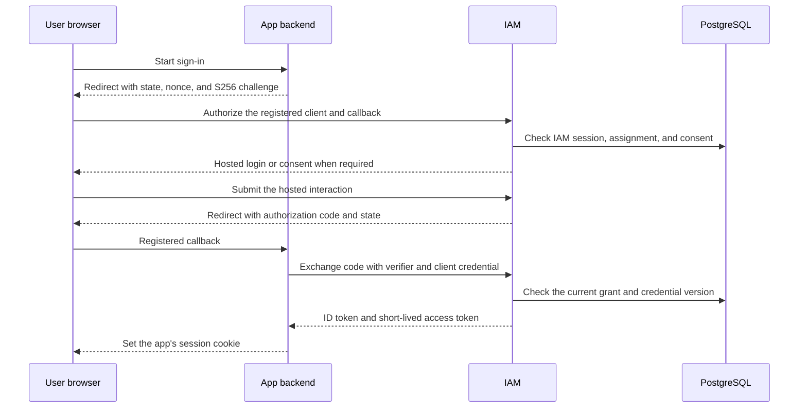

# Application access

> **POC reference.** This guide documents the retired implementation. For the v1 rewrite, see the [current docs](README.md#v1-rewrite).

An organization registers an application and receives a private installation
and a confidential OAuth client. The installation is the scope for member
assignments, app roles, credentials, and audit activity. Registration creates
no member assignments. An organization role gives a member administrative
powers for that organization. App access requires an explicit assignment.

[Documentation index](https://github.com/xcvzmoon/identity-and-access-management/blob/31d96060a63a7613d10e7634a49c1822687c5381/docs/README.md) · [Application administration](administer.md)

## Tenant and role boundaries

| Scope                 | Authority                                                                                                                          |
| --------------------- | ---------------------------------------------------------------------------------------------------------------------------------- |
| Organization          | A member is an `owner`, `admin`, or `member`. Admin operations also require a recent passkey check.                                |
| Application           | A permission catalog defines product-specific keys. Each app can use its own names and meanings.                                   |
| Installation          | Roles group permissions for this installation. Assignments bind an eligible organization member to the installation.               |
| Protected app request | Current roles on the assignment produce a distinct set of permission keys. The app checks the expected key and resource ownership. |

An assignment with an empty role list permits sign-in and yields an empty
permission set. Two installations can both define a role called `editor`
with different permissions. A verified user who belongs to two organizations
has separate member records and assignments. The server resolves the
organization for each app or installation ID. It checks membership against
that organization. Composite foreign keys prevent associations across
installations and organizations.

The organization plugin's public creation and deletion paths are unavailable.
The administration UI depends on an existing organization and owner
membership. The web integration suites seed these records as fixture data.
Deployment must arrange initial organization and owner provisioning as an
operator responsibility.

[Database model](database.md#organizations-and-application-access) ·
[Management API](management-api.md)

## Browser authorization

The authorization request supports the `openid` scope and Authorization Code
grant. IAM requires S256 PKCE for registered clients. A registration stores
one exact HTTPS redirect URI. The callback parser rejects credentials,
wildcard hosts, fragments, and URLs that change when parsed and serialized.
The hosted login and consent pages carry provider-signed request state.
Nitro checks the expected destination before returning a redirect.

Use a server-side OIDC SDK for discovery, state and nonce validation, code
exchange, and ID token validation. Key the app's local identity by issuer and
subject. Protocol fields such as `client_id` and `redirect_uri` follow the
wire standard, while IAM's own JSON uses names such as `clientId` and
`redirectUri`.

[OIDC route reference](http-api.md#oidc-and-hosted-interactions) ·
[Client integration](integrate-app.md)

## Live access checks

Before authorization and code exchange, IAM looks up the current grant using
the client, user, and exact callback. The grant version combines the
assignment version and the OAuth credential version. The provider binds the
authorization code, consent reference, and access token to that version.
The access token lasts five minutes.

Introspection authenticates the OAuth client and checks the token's current
session, account, organization, client, and assignment. It returns the current
permission set. UserInfo runs a live grant check and returns `sub` alone.
Token expiry and signature verification are useful for validating tokens.
Immediate permission and revocation decisions depend on introspection.
When introspection fails, the app denies the operation.

| Change                                   | Effect on access                                                                                                                   |
| ---------------------------------------- | ---------------------------------------------------------------------------------------------------------------------------------- |
| Edit the permissions in a role           | The next live check uses the edited permission set.                                                                                |
| Revoke an assignment                     | Live token checks fail. A later grant requires fresh authorization and consent.                                                    |
| Suspend a member                         | Grants for that organization stop working. IAM advances assignment versions, so reinstatement leaves old tokens and codes invalid. |
| Replace callback or rotate client secret | The credential version advances. Current access tokens and outstanding codes become stale.                                         |
| Disable the OAuth client                 | The app can no longer start new authorization and live checks reject earlier credentials.                                          |
| Sign out or reset the IAM password       | Live checks fail for tokens tied to the revoked IAM session.                                                                       |
| Revoke a machine key                     | That key fails subsequent machine installation checks.                                                                             |

[Contain a pilot app](pilot.md#stop-a-pilot-app) ·
[Access lookup functions](database.md#access-functions)

## Credentials and callers

| Credential                           | Caller and purpose                                                                                                            |
| ------------------------------------ | ----------------------------------------------------------------------------------------------------------------------------- |
| IAM session cookie                   | Browser on the canonical IAM origin. It identifies the user for hosted interactions.                                          |
| OAuth client secret                  | App backend. It authenticates token exchange, introspection, and revocation through its registered method.                    |
| Authorization code and PKCE verifier | The app receives the code at its callback. The backend supplies the verifier and client credentials when exchanging it.       |
| ID token                             | The app validates the user's sign-in and sets its own session.                                                                |
| Access token                         | The app backend sends it to IAM for introspection, UserInfo, or revocation.                                                   |
| Machine key                          | The app backend sends it to the installation lookup endpoint. The key has an installation binding and a dedicated read scope. |
| Issuer signing key                   | IAM signs tokens with RS256. Clients use the public JWKS for verification.                                                    |

The Better Auth API key plugin checks machine key material and quota. IAM
then checks the current principal, installation, organization, scope, and
status. The machine key has no user subject and grants no administrative
access. The product uses hosted sign-in for external apps. The email/password
endpoints support IAM's own UI on its origin.

[Machine integration](integrate-app.md#machine-access) ·
[Issuer key operations](pilot.md#rotate-the-issuer-signing-key)
