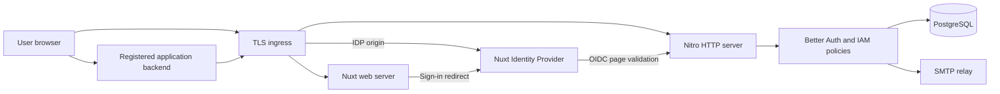

# System architecture

Web serves account and administration pages. IDP serves authentication
pages, and the Nitro API handles HTTP and OIDC endpoints. In production, ingress terminates TLS for the web and IDP hostnames. The
API and OIDC issuer use the web hostname.
PostgreSQL holds shared state, and the API sends account email through an
optional SMTP relay.

[Documentation index](README.md) · [Deployment](deployment.md)

## Runtime boundaries

| Boundary                       | Responsibility                                                                                                                                                          |
| ------------------------------ | ----------------------------------------------------------------------------------------------------------------------------------------------------------------------- |
| Browser to IAM                 | Web and IDP use separate same-site origins. Browser writes validate their origin. The API session travels in an HTTP-only cookie.                                       |
| Registered app to IAM          | Browser redirects initiate authorization. The app server uses its confidential client credential for token operations. Machine installation lookup has a dedicated key. |
| Ingress to Nitro               | Ingress replaces forwarding headers. Nitro trusts configured peer IPs. The public host and scheme must match the issuer settings.                                       |
| Nitro to PostgreSQL            | The runtime role uses named grants. Migration, audit access, and the alert collector run with separate privileges.                                                      |
| Nitro to SMTP                  | The relay delivers verification, recovery, and invitation messages when configured. The API owns relay credentials.                                                     |
| Registered app to its own data | The app owns its session and business records. IAM supplies the user's identity, app grant, and permission keys. The app enforces object-level access.                  |

## Request dispatch

1. Web serves the account and admin shell. The route middleware checks the
   API session and sends signed-out visitors to the IDP origin.
2. IDP serves the authentication pages. For OIDC sign-in or consent, it calls
   the API to validate the signed request and uses the verified callback
   origin in the form policy. Regular sign-in returns the browser to web
   after the API establishes a session.
3. The API middleware applies no-store and origin handling to `/api` and
   child routes. It requires an IAM session for generic API routes. The auth
   gateway and hosted handlers apply their endpoint-specific authorization.
4. The auth gateway matches the HTTP method and path to an explicit allowlist.
   It normalizes request headers, applies body limits, and dispatches to
   Better Auth. Discovery uses a separate handler at the issuer root.
5. Better Auth and IAM plugins enforce credentials, sessions, client state,
   passkeys, tenant membership, and grants. Drizzle reads and writes the
   shared PostgreSQL state.

[Browser routes](browser.md) · [HTTP request rules](http-api.md#request-authorization)

## Build and process lifecycle

The build compiles shared utilities before the database package. It then
builds the full shared package and auth package. The API, IDP, and web each
produce their own `.output/server/index.mjs`. Locally, web listens on port 5173. It forwards API requests to port 3000 and redirects auth pages to
the IDP origin on port 5176.

The Nitro startup plugin initializes the auth singleton and registers a hook
to close the database pool at shutdown. Each process creates its own lazy
pool. Replicas share the issuer settings, auth secret, and database state.
PostgreSQL backs rate counters, sessions, codes, grants, and signing keys.
An advisory lock coordinates issuer-key writes across replicas.

[Build commands](development.md) · [Configuration](http-api.md#configuration) ·
[Replica checks](pilot.md#pilot-replica-check)

## Source map

| Area                                       | Entry points                                                                                                                                                                     |
| ------------------------------------------ | -------------------------------------------------------------------------------------------------------------------------------------------------------------------------------- |
| API route registration and trusted proxies | [Nitro configuration](../apps/api/nitro.config.ts) · [Server entry](../apps/api/server/entry.ts)                                                                                 |
| Web routes and local forwarding            | [Nuxt config](../apps/web/nuxt.config.ts) · [Local routing](../apps/web/server/middleware/upstreams.ts)                                                                          |
| HTTP authorization and dispatch            | [API middleware](../apps/api/server/middleware/auth.ts) · [Auth gateway](../apps/api/server/api/auth/%5B...all%5D.ts) · [Request helpers](../apps/api/server/utils/auth-http.ts) |
| Hosted login and consent                   | [OIDC interaction adapter](../apps/api/server/utils/oidc-interaction.ts) · [Hosted form handler](../apps/api/server/api/oidc/%5Bstep%5D.post.ts)                                 |
| Auth policy composition and lifecycle      | [Auth factory](../packages/auth/src/utils/auth.ts) · [Auth singleton](../packages/auth/src/utils/use-auth.ts) · [Nitro lifecycle](../apps/api/server/plugins/lifecycle.ts)       |
| Tenant permission decisions                | [Live access queries](../packages/database/src/utils/application-access.ts) · [Access writes](../packages/database/src/utils/manage-application-access.ts)                       |
| Provisioning and packaging                 | [Build script](../scripts/build.ts) · [Dockerfile](../Dockerfile) · [Compose](../compose.yaml)                                                                                   |
