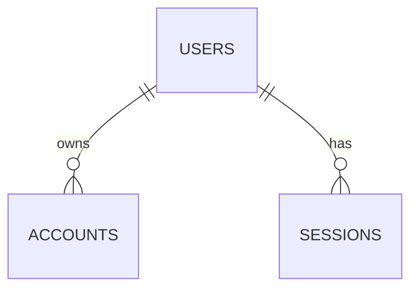
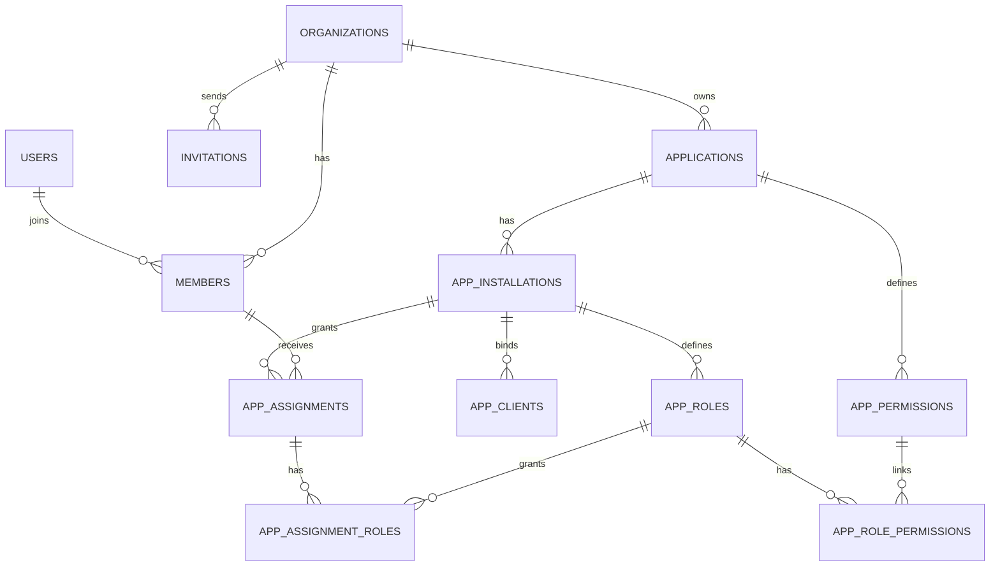

# Database reference

[Documentation index](README.md)

`@iam/database` owns the PostgreSQL pool, schema, relations, and migrations.
The workspace catalog pins the `postgres` driver, Drizzle ORM, and Drizzle Kit.
See the [database operations guide](database-operations.md) for deployment and recovery.

## Configuration

Run `vp run create-env` from the repository root and fill in the PostgreSQL
connection details for your existing server. The [database example](../packages/database/.env.example)
shows the values written to `packages/database/.env`.

| Variable                 | Use                                                                                                                                                                      |
| ------------------------ | ------------------------------------------------------------------------------------------------------------------------------------------------------------------------ |
| `APP_ENV`                | `local` reads the database workspace's `.env` and gives process variables precedence. `testing`, `staging`, and `production` take their settings from process variables. |
| `DB_HOST`                | PostgreSQL host reachable from the caller. Host migrations use this value directly.                                                                                      |
| `DB_PORT`                | PostgreSQL port. Defaults to `5432`.                                                                                                                                     |
| `DB_USER`, `DB_PASSWORD` | PostgreSQL role and password.                                                                                                                                            |
| `DB_DATABASE`            | PostgreSQL database name. The auth SQL schema inside that database is named `iam`.                                                                                       |
| `DB_SSL`                 | Set to `"true"` when the server requires TLS. Defaults to `false`.                                                                                                       |
| `DB_LOGGER`              | Query logger flag for the internal client factory. The shared runtime client disables it to protect credentials and session tokens. Defaults to `false`.                 |

The migration and application commands use the same validated settings.
The API container can reach the host through `host.docker.internal`, with
`DOCKER_DB_HOST` available as a Compose override. See the
[container setup](local.md#containers).

### PostgreSQL TLS in deployment

Set `DB_SSL="true"` in the API and migration job. Use a `DB_HOST` covered
by the PostgreSQL server certificate. For a private CA, make its PEM bundle
readable inside both processes and set `NODE_EXTRA_CA_CERTS` to that path
before Node starts. IAM verifies the certificate chain and host when TLS is
enabled. Configure PostgreSQL to require TLS from the IAM network.
[PostgreSQL TLS configuration](https://www.postgresql.org/docs/current/ssl-tcp.html)

For `psql` and other PostgreSQL command-line clients, set
`PGSSLMODE="verify-full"` and point `PGSSLROOTCERT` at the trusted CA bundle.
[PostgreSQL client TLS verification](https://www.postgresql.org/docs/current/libpq-ssl.html)

## Public API

`@iam/database` exposes `schema` and `useDatabase()`. The
`@iam/database/schema` subpath exposes schema declarations for consumers such
as the shared validation package.

```ts
import { schema, useDatabase } from '@iam/database';

const database = useDatabase();
const users = await database.select().from(schema.users).limit(1);
```

`useDatabase()` initializes one client per process and returns the same client
on subsequent calls. The pool connects on the first query. The server that
owns the process lifecycle closes it with `await database.$client.end()` at
shutdown. Keep database operations in server code.

## Authentication tables

The definitions are in [the auth schema](../packages/database/src/schema/auth.ts). The Drizzle
Relations v2 mappings are in [relations.ts](../packages/database/src/relations.ts).

| Table               | Stored data                                                                             |
| ------------------- | --------------------------------------------------------------------------------------- |
| `iam.users`         | User identity, unique email, verification flag, and profile fields                      |
| `iam.accounts`      | Credential accounts and provider fields. The password field stores the credential hash. |
| `iam.sessions`      | Unique session token, expiry, user reference, and optional client metadata              |
| `iam.verifications` | Verification identifiers, values, and expiry                                            |
| `iam.rate_limits`   | Shared rate-limit key, count, and last-request timestamp                                |



Accounts and sessions reference `users.id`, are indexed by `user_id`, and
cascade when the user is deleted. Verification and rate-limit rows have
their own keys and no foreign key to users.

`generateUuid()` supplies UUIDv7 IDs through a Drizzle runtime default.
Raw SQL inserts must supply their own IDs. `generateTimestamps()` adds
creation, update, and nullable deletion columns. Drizzle updates `updatedAt`
on writes through its runtime hook. Timestamps use millisecond precision
and time zones. The audit variant adds actor IDs for callers that supply
them. See the [column helpers](../packages/database/src/helpers/index.ts).

Organization, application, role, OAuth, and machine-key tables live in the
same schema. Installation and role relations preserve app and organization
boundaries. The application grant joins a member to an installation.
[Schema exports](../packages/database/src/schema/index.ts) · [App assignments](administer.md#application-permissions-and-assignments)

## Organizations and application access

The tables below are in the `iam` schema.

| Table                  | Scope and stored state                                                            |
| ---------------------- | --------------------------------------------------------------------------------- |
| `organizations`        | Tenant record, including a disable timestamp.                                     |
| `members`              | Unique organization and user membership, organization role, and suspension state. |
| `invitations`          | Organization, recipient email, role, inviter, status, and expiry.                 |
| `applications`         | Private registration and its owning organization.                                 |
| `app_installations`    | Deployment scope for an organization-owned app.                                   |
| `app_clients`          | Binding between an OAuth client and an installation, with a credential version.   |
| `app_assignments`      | Membership-to-installation grant with independent version and deletion state.     |
| `app_permissions`      | Permission keys scoped to the application.                                        |
| `app_roles`            | Named roles scoped to the installation.                                           |
| `app_role_permissions` | Permission links constrained to a role and its app's permission catalog.          |
| `app_assignment_roles` | Links constrained to an assignment and a role in the same installation.           |
| `app_access_events`    | Actor and installation IDs, action, JSON details, and event time.                 |



The application and installation foreign key includes the owning organization.
The assignment foreign keys include that same organization on both the
installation and membership. Role permission links include the app ID.
Assignment role links include the installation ID. These constraints back
the tenant checks in the service.

[Organization schema](../packages/database/src/schema/organizations.ts) ·
[Applications schema](../packages/database/src/schema/applications.ts) ·
[Roles schema](../packages/database/src/schema/application-roles.ts)

## Provider and credential tables

| Tables                                                                 | Stored state                                                                                                                                               |
| ---------------------------------------------------------------------- | ---------------------------------------------------------------------------------------------------------------------------------------------------------- |
| `oauth_clients`                                                        | Provider registration, secret material, callbacks, allowed protocol settings, and disabled state.                                                          |
| `oauth_consents`                                                       | Client and user consent scoped to the provider's reference for a grant.                                                                                    |
| `oauth_access_tokens`, `oauth_refresh_tokens`                          | Token persistence tables supplied by the provider schema. This issuer configures the Authorization Code grant and exposes no refresh grant.                |
| `oauth_resources`, `oauth_client_resources`, `oauth_client_assertions` | Provider schema for resource metadata, client bindings, and assertion tracking.                                                                            |
| `jwks`                                                                 | Key IDs, public keys, encrypted private signing keys, algorithm, and times.                                                                                |
| `passkeys`                                                             | Per-user credential ID, public key, counter, and authenticator metadata. The associated admin verification timestamp and credential ID live in `sessions`. |
| `api_keys`                                                             | Better Auth machine key hashes, configuration and ownership references, quotas, and lifecycle fields.                                                      |
| `app_machine_principals`, `app_machine_keys`                           | Installation principals and the link between each principal and its current key.                                                                           |

[OAuth schema](../packages/database/src/schema/oauth.ts) ·
[Passkey schema](../packages/database/src/schema/passkeys.ts) ·
[Machine key schema](../packages/database/src/schema/application-machine-keys.ts)

## Access functions

These exports accept an IAM database or transaction. Pass identifiers from
a caller that has already authenticated the actor or validated the protocol
credential. The read functions return `null` when the active state cannot
be resolved.

| Export                                                                                              | Contract                                                                                                               |
| --------------------------------------------------------------------------------------------------- | ---------------------------------------------------------------------------------------------------------------------- |
| `resolveApplicationAccess(database, clientId, userId, permissionKey?)`                              | Returns the installation ID for an active grant. When a permission is supplied, the grant must include it.             |
| `resolveApplicationGrant(database, clientId, userId, redirectUri?)`                                 | Returns the current grant version. When a callback is supplied, it must match the registered value exactly.            |
| `readApplicationTokenAccess(database, clientId, userId, sessionId)`                                 | Returns installation ID, grant version, and current permissions after checking the token's live IAM session and grant. |
| `registerApplicationPermissions`                                                                    | Validates and adds keys to an application catalog.                                                                     |
| `saveApplicationRole`                                                                               | Creates or updates an installation role and writes the complete permission mapping.                                    |
| `changeApplicationAssignment`                                                                       | Grants or revokes access for an eligible member and writes the role mapping on grants.                                 |
| `ApplicationAccessError`                                                                            | Typed failure raised by the application's access management layer.                                                     |
| `applicationPermissionKeysSchema`, `applicationRoleInputSchema`, `applicationAssignmentInputSchema` | Boundary validators reused by the administrator endpoint.                                                              |

The access writes check the actor's management authority and validate the app,
installation, membership, and catalog relationships inside the transaction.
An app access event records the change. Auth entry points check the administrator
session and recent passkey verification before invoking the writes.

[Access function source](../packages/database/src/utils/application-access.ts) ·
[Management function source](../packages/database/src/utils/manage-application-access.ts)

## Migration history

Migration directories contain the SQL and its corresponding Drizzle snapshot.
Apply them in timestamp order. The history table is in the separate `drizzle`
schema. Use the [migration procedure](database-operations.md#schema-and-migrations).

| Migration                                                                                                                                  | Main change                                                                          |
| ------------------------------------------------------------------------------------------------------------------------------------------ | ------------------------------------------------------------------------------------ |
| [`iam_auth`](../packages/database/drizzle/20261117105447_iam_auth/migration.sql)                                                           | Creates `iam` and the core auth tables.                                              |
| [`app_registration`](../packages/database/drizzle/20261118000430_app_registration/migration.sql)                                           | Adds organizations, membership, invitations, private apps, clients, and assignments. |
| [`oauth_provider_storage`](../packages/database/drizzle/20261118000906_oauth_provider_storage/migration.sql)                               | Adds provider tables, the OAuth client foreign key, and JWKS.                        |
| [`application_rbac`](../packages/database/drizzle/20261118001252_application_rbac/migration.sql)                                           | Adds app permission catalogs, installation roles, links, and audit events.           |
| [`application_grant_version`](../packages/database/drizzle/20261118003050_application_grant_version/migration.sql)                         | Adds an assignment grant version.                                                    |
| [`application_client_credential_version`](../packages/database/drizzle/20261118003558_application_client_credential_version/migration.sql) | Adds an OAuth credential version for each client binding.                            |
| [`application_machine_keys`](../packages/database/drizzle/20261118004219_application_machine_keys/migration.sql)                           | Adds API key records and installation principal bindings.                            |
| [`admin_passkeys`](../packages/database/drizzle/20261118005604_admin_passkeys/migration.sql)                                               | Adds passkey storage and session step-up fields.                                     |
| [`retire_eddsa_signing_keys`](../packages/database/drizzle/20261118050454_retire_eddsa_signing_keys/migration.sql)                         | Retires EdDSA signing keys during the switch to RS256.                               |
| [`revoke_unverified_sessions`](../packages/database/drizzle/20261118090330_revoke_unverified_sessions/migration.sql)                       | Removes sessions for accounts with unverified email.                                 |
