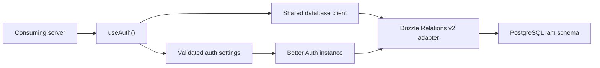

# @iam/auth

This server package configures Better Auth for the workspace. It owns
credential verification, API session cookies, and rate-limit policy. The
[API](../../apps/api/README.md) handles HTTP routing and applies request
authorization. The [web app](../../apps/web/README.md) consumes the API over
HTTP and manages its own sealed view of a signed-in user.

## Initialization

`useAuth()` is the server entry point. On its first call it validates auth
configuration, obtains the shared PostgreSQL client through `useDatabase()`,
and initializes Better Auth. Later calls in the same process reuse that
instance. The consuming server owns request handling and database shutdown.



```ts
import { useAuth } from '@iam/auth';

export async function readSession(request: Request) {
  return useAuth().api.getSession({
    headers: request.headers,
    returnHeaders: true,
  });
}
```

The returned headers can include `Set-Cookie` when Better Auth renews or clears
the API session. Forward those headers on the consuming response. Use
`useAuth().handler(request)` when mounting Better Auth's HTTP routes.

## Configuration

Run `vp run create-env` from the repository root for local credentials and
secrets. The auth loader reads [its workspace example](.env.example) via
`packages/auth/.env` in local mode. Process variables win over local file values.
Testing, staging, and production use process variables for configuration.

| Variable          | Purpose                                                                                                                           |
| ----------------- | --------------------------------------------------------------------------------------------------------------------------------- |
| `APP_ENV`         | Selects `local`, `testing`, `staging`, or `production`.                                                                           |
| `AUTH_SECRET`     | Better Auth secret, at least 32 characters. Generate with `openssl rand -base64 32` and share the same value across API replicas. |
| `AUTH_URL`        | Public API origin used as Better Auth's base URL.                                                                                 |
| `AUTH_WEB_ORIGIN` | Public web origin added to Better Auth's trusted origins.                                                                         |

Use exact HTTP origins such as `http://localhost:3000` and
`http://localhost:5173`, without paths or trailing slashes. Use HTTPS for
production origins. Database fields are configured through the [database
package](../database/README.md#configuration). Keep `AUTH_SECRET` in the API
process. Nuxt's separate session secret belongs to the web process.

## Credential and session policies

### Email and password

The project enables email and password registration and sign-in. Better Auth
validates credential requests and requires passwords between 12 and 128
characters. It uses its default scrypt hashing and stores the hash on the
credential account. The policy is configured in [the auth factory](src/utils/auth.ts).

Registration writes the user and credential account. Successful sign-in
creates a session and sends the API session cookie. Sign-out ends the current
session. Email verification delivery, password reset delivery, and OAuth
providers would each need configuration in the auth factory before those
flows are available. [Better Auth email and password documentation](https://better-auth.com/docs/authentication/email-password)

### Persistence and cookies

The PostgreSQL adapter uses Drizzle Relations v2 with the `iam` schema,
plural table names, and transactions enabled. Drizzle supplies UUIDv7
identifiers because Better Auth's ID generation is disabled. See the
[database schema](../database/README.md#authentication-tables) for table
ownership and migration details.

Better Auth stores session records in PostgreSQL and uses its signed
`better-auth.session_token` cookie to identify the session. HTTPS uses the
`__Secure-` prefix. The cookie is HTTP-only and SameSite Lax. Session reads
can renew the cookie and extend the stored expiry. The current Better Auth
defaults are a seven-day lifetime and a one-day refresh interval. The project
uses database lookups for session validation and leaves cookie caching disabled.
[Better Auth session management](https://better-auth.com/docs/concepts/session-management)

### Origins, rate limits, and logs

Origin and CSRF checks are enabled. The package trusts the configured web
origin in addition to Better Auth's base-origin behavior. The consuming HTTP
server is responsible for its own routing and protection of application
endpoints.

Rate limiting is enabled in all environments and stores counters in
`iam.rate_limits`, so replicas share counters through PostgreSQL. The auth
factory leaves thresholds and per-route limits at Better Auth's defaults.
The server ingress supplies client IP information used to resolve rate-limit
buckets. Better Auth warnings and errors are reduced to `AUTH_WARNING` and
`AUTH_ERROR` in the package logger, keeping request and query details out of the
log messages.

## Validation

Run the package's validation and build scripts from the repository root.

```sh
vp run '@iam/auth#typecheck'
vp run '@iam/auth#test'
vp run '@iam/auth#build'
```

Use `vp run build` first on a fresh checkout so the package's dependencies have
build outputs. The package tests cover configuration validation and singleton
reuse. Credential, storage, and revocation flows are exercised by the
[API integration tests](../../apps/api/README.md#validation).
