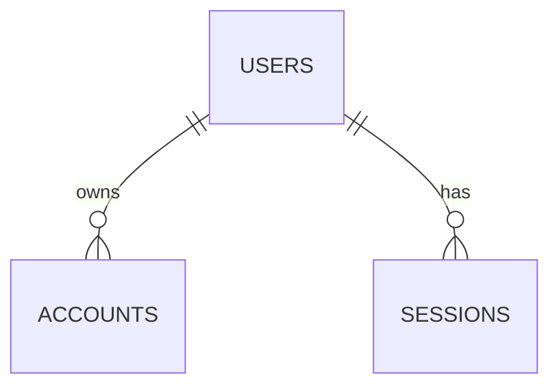

# @iam/database

This server package owns the PostgreSQL pool, schema, relations, and migration
scripts. It uses the `postgres` driver and Drizzle ORM and Kit pinned to
`1.0.0-rc.5-5935859` in the workspace catalog.

## Configuration

Run `vp run create-env` from the repository root and fill in the PostgreSQL
connection details for your existing server. The [database example](.env.example)
shows the values written to `packages/database/.env`.

| Variable                 | Use                                                                                                                                                                      |
| ------------------------ | ------------------------------------------------------------------------------------------------------------------------------------------------------------------------ |
| `APP_ENV`                | `local` reads the database workspace's `.env` and gives process variables precedence. `testing`, `staging`, and `production` take their settings from process variables. |
| `DB_HOST`                | PostgreSQL host reachable from the caller. Host migrations use this value directly.                                                                                      |
| `DB_PORT`                | PostgreSQL port. Defaults to `5432`.                                                                                                                                     |
| `DB_USER`, `DB_PASSWORD` | PostgreSQL role and password.                                                                                                                                            |
| `DB_DATABASE`            | PostgreSQL database name. The auth SQL schema inside that database is named `iam`.                                                                                       |
| `DB_SSL`                 | Set to `"true"` when the server requires TLS. Defaults to `false`.                                                                                                       |
| `DB_LOGGER`              | Query logger flag for the internal client factory. The shared runtime client disables it to protect credentials and session tokens. Defaults to `false`.                 |

The migration and application commands use the same validated settings.
The API container can reach the host through `host.docker.internal`, with
`DOCKER_DB_HOST` available as a Compose override. See the
[container setup](../../README.md#containers).

## Public API

`@iam/database` exposes `schema` and `useDatabase()`. The
`@iam/database/schema` subpath exposes schema declarations for consumers such
as the shared validation package.

```ts
import { schema, useDatabase } from '@iam/database';

const database = useDatabase();
const users = await database.select().from(schema.users).limit(1);
```

`useDatabase()` initializes one client per process and returns the same client
on subsequent calls. The pool connects on the first query. The server that
owns the process lifecycle closes it with `await database.$client.end()` at
shutdown. Keep database operations in server code.

## Authentication tables

The definitions are in [the auth schema](src/schema/auth.ts). The Drizzle
Relations v2 mappings are in [relations.ts](src/relations.ts).

| Table               | Stored data                                                                             |
| ------------------- | --------------------------------------------------------------------------------------- |
| `iam.users`         | User identity, unique email, verification flag, and profile fields                      |
| `iam.accounts`      | Credential accounts and provider fields. The password field stores the credential hash. |
| `iam.sessions`      | Unique session token, expiry, user reference, and optional client metadata              |
| `iam.verifications` | Verification identifiers, values, and expiry                                            |
| `iam.rate_limits`   | Shared rate-limit key, count, and last-request timestamp                                |



Accounts and sessions reference `users.id`, are indexed by `user_id`, and
cascade when the user is deleted. Verification and rate-limit rows have
their own keys and no foreign key to users.

`generateUuid()` supplies UUIDv7 IDs through a Drizzle runtime default.
Raw SQL inserts must supply their own IDs. `generateTimestamps()` adds
creation, update, and nullable deletion columns. Drizzle updates `updatedAt`
on writes through its runtime hook. Timestamps use millisecond precision
and time zones. The audit variant adds actor IDs for callers that supply
them. See the [column helpers](src/helpers/index.ts).

## Schema and migrations

Export schema tables from [src/schema/index.ts](src/schema/index.ts) and add
relations to [src/relations.ts](src/relations.ts). The auth definitions were
adapted from the Better Auth 1.7.25 schema. Use the shared Valibot contracts
when a consumer needs portable schemas derived from these tables.

Use the root alias to run the migration workflow.

```sh
vp run packages:database generate --output json
vp run packages:database check
vp run packages:database migrate
```

1. `generate` writes a new SQL migration and snapshot under `drizzle/`.
   Review the generated SQL and commit the matching snapshot.
2. `check` validates migration history and snapshot consistency.
3. `migrate` applies pending SQL and records it in the separate `drizzle`
   schema. Apply it before starting the API against the new schema.

With the default workspace configuration, `migrate` checks `DB_DATABASE`
before invoking Drizzle Kit. If PostgreSQL reports that it is missing, the
wrapper connects to the `postgres` maintenance database on the same server
and creates the configured database. The creation step needs `CREATEDB` and
access to `postgres`. The role applying the SQL also needs permission to
create or alter the affected objects. The API runtime needs access to the
resulting `iam` schema and tables.

The initial migration creates the `iam` schema and all five auth tables. An
existing database with earlier, untracked auth tables needs a reconciliation
migration that preserves its SQL and migration history.

The workspace also exposes `vp run packages:database push` for applying schema
changes directly, `vp run packages:database pull` for introspection, and
`vp run packages:database studio` for inspection. Use the migration workflow
for tracked releases. Keep database errors inside the server boundary and
redact details that can contain SQL parameters.

## Validation

```sh
vp run packages:database build
vp run packages:database typecheck
vp run packages:database check
vp run test packages/database/tests
```

Use `vp run build` first on a fresh checkout to build the shared utility
entry point that this package consumes. Unit tests cover configuration,
runtime defaults, and lazy pool reuse. The [API integration
suite](../../apps/api/README.md#validation) covers real auth queries against
a disposable PostgreSQL database.
